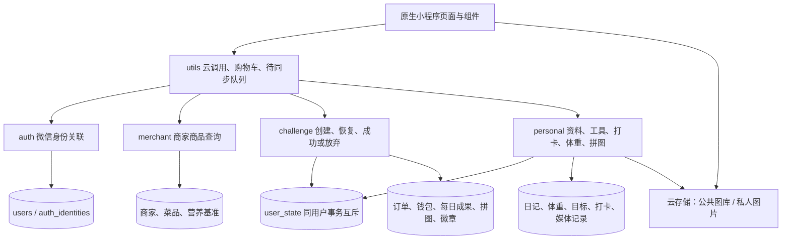

# 不忍了项目框架

本文件描述2026-09-09源码结构和数据流；实际云端进度见《实施状态》。本项目是微信原生小程序与微信云开发，没有React/Vue前端、独立HTTP服务或SQL数据库。

## 目录职责

```text
miniprogram/       小程序页面、组件、样式、云函数调用封装、内置音频图标
cloudfunctions/    用户业务云函数及开发管理函数，各自独立部署
shared/domain/    金额/热量、挑战奖励、个人统计、动态拼图纯规则源文件
shared/media/     图片格式、尺寸、EXIF元数据解析源文件
scripts/          共享副本同步、种子/图片映射、图库尺寸、测试和交接包同步
data/source/      商品源数据；不因断点备份重跑导入
data/assets/      本地素材、系统图及商家原件清单
deploy/           已确认的存储安全规则和当前环境系统图库配置
docs/             产品基线、框架、进度、数据库/接口、操作及验收依据
CYZ_do_list/      用户/agent实际完成记录；与设计文档分开
```

`miniprogram/app.json`注册19个页面。`home`、`merchant`、`order`、`wait`、`result`组成挑战主流程；`tools`及`woodfish`、`diary`、`diary-edit`、`reverse`、`card`组成工具；`me`及`cards`、`photo`、`profile`、`wallet`、`weight`、`calendar`、`badges`组成个人中心与图片流程。共享组件包括挑战提示和体重曲线。

## 调用与数据流



客户端不信任自己传入的userId。业务云函数从微信OPENID关联内部userId，按归属执行查询或写入，统一返回`{success,data?,error?}`。公共资料可读；日记、体重等业务集合禁客户端直连。

## 挑战结算

`challenge/index.js`负责入口与身份，`challenge/service.js`负责事务和业务编排。创建保存单商家快照、startedAt/expiresAt和幂等键，不写钱包。

客户端展示剩余时间，显示到零时查询服务端；自动成功使用expiresAt而非重新打开时刻。创建/结算都读写user_state，完成订单、钱包流水、累计状态、每日成功、拼图和徽章同一事务提交。订单终态不可被重复操作改写。

木鱼、日记和体重等业务位于`personal/service.js`。用户状态共享事务锁；木鱼按设备累计差去重，日记用版本处理编辑冲突，体重使用幂等请求ID并保留阶段与历史。

## 拼图与图片

`shared/domain/puzzle.js`是动态网格和均分规则源文件；服务端保存图片尺寸、网格、布局修订、currentStep和revealedTileIndexes，历史进度按订单唯一。成功次数与每日打卡分开。

`photo`页面选择原图、预览并等比缩小；personal/media.prepare申请随机路径，客户端上传，media.commit从实际云文件解析格式/方向/尺寸并检查归属后才能绑定。头像裁剪独立。公共系统图从memorial_presets读取，用户私图需通过存储归属规则和业务归属检查。

`miniprogram/config.js`与personal环境变量的PRIVATE_MEDIA_READY是双开关；当前都未启用。存储规则已保存不代表可以跳过第二身份测试。

## 修改、验证和部署边界

纯规则先改`shared/`，再执行`node scripts/sync-domain.js`同步至各云函数lib及小程序domain；这些副本必须一起提交。不要只改某一份生成副本。接口和集合变更同步《接口契约》《数据库设计》《数据库索引》。

本地检查：`npm test --prefix scripts`与`node scripts/check-miniprogram.js`。它们覆盖规则和静态结构，不能替代真实云端事务、权限和真机体验检查。

initDatabase、seed、storageProbe是开发管理函数，不能当作用户API；quickstartFunctions等模板遗留文件的存在不代表产品采用或云端部署。正式发布前处理管理入口。

Git提交保存代码和文档；上传云函数、修改索引/权限、改变云数据是独立动作。断点整理不重新部署，不调用seed，也不清理云数据。
